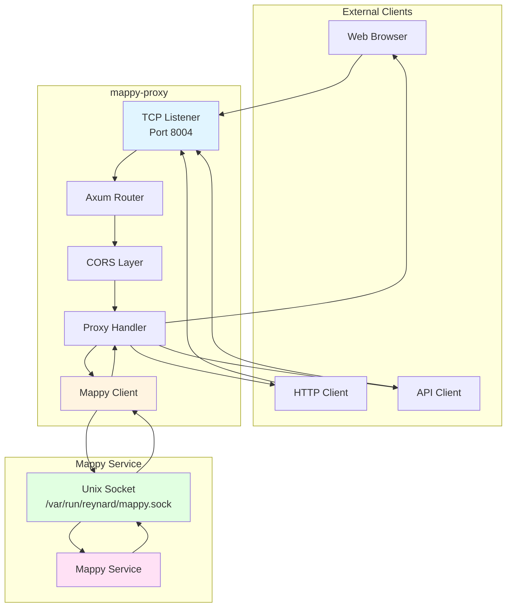
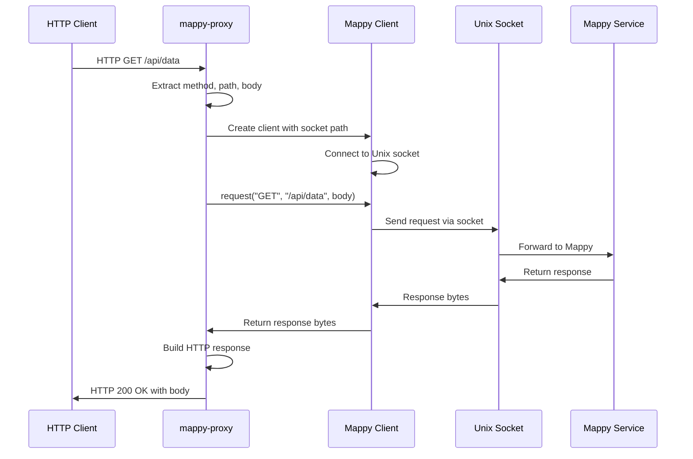
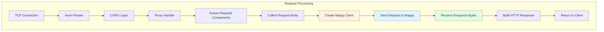

# mappy-proxy

An HTTP proxy service that provides a TCP endpoint for the Mappy service. This service enables external clients to communicate with the Mappy service over Unix domain sockets by translating HTTP requests to the Mappy client protocol.

## What This Service Does

This service acts as a translation layer between HTTP clients and the Mappy service. The Mappy service communicates over Unix domain sockets for security and performance, which makes it inaccessible to external TCP clients. The proxy solves this by listening on a TCP port and forwarding HTTP requests to the Mappy service via the mappy-client library.

The proxy accepts HTTP requests on a configurable TCP port, extracts the method, path, headers, and body, then uses the mappy-client to communicate with the Mappy service over its Unix socket. The response from Mappy is returned to the HTTP client with appropriate headers.

## Architecture Overview



## Installation

This service is part of the Reynard monorepo. Build it using the workspace Cargo:

```bash
cd services/mappy/mappy-proxy
cargo build --release
```

The binary will be available at `target/release/mappy-proxy`.

## Configuration

The proxy is configured through environment variables:

- `MAPPY_SOCKET_PATH`: Path to the Unix socket to forward requests to (default: `/var/run/reynard/mappy.sock`)
- `MAPPY_PROXY_PORT`: TCP port to listen on (default: `8004`)

Example:

```bash
export MAPPY_SOCKET_PATH=/var/run/my-service.sock
export MAPPY_PROXY_PORT=9000
./mappy-proxy
```

## Core Concepts

### HTTP Request Forwarding

The proxy receives HTTP requests and forwards them to the Mappy service using the mappy-client library. The process involves extracting request components and translating them to the Mappy protocol.



The proxy uses the mappy-client library to handle the Unix socket communication. This abstraction simplifies the proxy implementation and ensures consistent protocol handling. The client is configured with the Unix socket path and provides a simple request method that takes the HTTP method, path, and optional body.

Request body handling uses the `http-body-util` crate to collect the complete body from the incoming request. The body is then passed to the mappy-client as a byte slice. Empty bodies are represented as `None` to optimize the request.

Response handling converts the raw bytes from Mappy into a UTF-8 string and builds an HTTP response with a 200 status code and JSON content type. The proxy forwards the `accept` header from the original request to preserve content negotiation preferences.

### CORS Support

Cross-Origin Resource Sharing (CORS) is enabled with permissive settings. The proxy allows requests from any origin with any method and any headers. This is appropriate for development and internal services where you want maximum flexibility. For production deployments, you may want to restrict the CORS policy to specific origins.

## Request Flow

The complete request lifecycle through the proxy involves several stages:



When a request arrives, Axum routes it through the CORS layer first. The proxy handler then extracts the HTTP method, URI, path, and headers from the request. The request body is collected using the `http-body-util` crate, which handles streaming bodies and converts them to a byte buffer.

The handler creates a mappy-client instance configured with the Unix socket path from the environment. The client handles the connection to the Unix socket and protocol translation. The request is forwarded to Mappy with the method, path, and optional body.

When Mappy returns the response bytes, the proxy converts them to a UTF-8 string and builds an HTTP response with a 200 status code. The response includes the original `accept` header to preserve content negotiation. Any errors during this process result in a 502 Bad Gateway response to the client.

## Error Handling

The proxy uses `anyhow` for error handling throughout. Errors are logged with appropriate context using the `tracing` crate. The handler logs both the method and path for successful requests and includes detailed error information when forwarding fails.

HTTP forwarding errors result in a 502 Bad Gateway response to the client. This includes connection failures to the Unix socket, mappy-client request failures, body collection errors, or response building errors. All errors are logged with context to aid in debugging.

## Performance Considerations

The proxy is built on Tokio for asynchronous I/O, allowing it to handle many concurrent connections efficiently. Each request is handled asynchronously without blocking the thread, enabling high throughput even under load.

The mappy-client library handles the Unix socket communication and connection pooling. This abstraction layer manages socket lifetimes and reuse, reducing the overhead of establishing new connections for each request.

Request body collection uses the `http-body-util` crate to efficiently stream and buffer incoming request bodies. This approach minimizes memory usage by only allocating what's needed for the actual body size.

The proxy uses Axum's built-in connection handling, which includes features like keep-alive and connection pooling. These are enabled by default and don't require configuration.

## Security Considerations

The proxy runs as a TCP listener on all interfaces (`0.0.0.0`). In production environments, you should either bind to a specific interface or use a firewall to restrict access. The Unix socket it connects to should have appropriate permissions to prevent unauthorized access.

CORS is currently set to allow all origins. In production, you should restrict this to known origins that need access to the service.

The proxy does not perform authentication or authorization. These should be handled by the backend service or by adding authentication middleware to the proxy if needed.

## Quick Start

### Running the Proxy

```bash
# With default settings
cargo run

# With custom configuration
MAPPY_SOCKET_PATH=/var/run/my-service.sock MAPPY_PROXY_PORT=9000 cargo run
```

### Connecting from an HTTP Client

```bash
curl http://localhost:8004/api/data
```

### Connecting from a Browser

```javascript
fetch('http://localhost:8004/api/data')
  .then(response => response.json())
  .then(data => console.log(data));
```

### Sending POST Requests

```bash
curl -X POST http://localhost:8004/api/data \
  -H "Content-Type: application/json" \
  -d '{"key": "value"}'
```

## Dependencies

The proxy uses the following key dependencies from the Reynard workspace:

- `tokio`: Async runtime for Rust
- `axum`: Web framework built on Tokio
- `hyper`: HTTP types and primitives
- `http-body-util`: HTTP body utilities for request/response handling
- `tower-http`: HTTP middleware including CORS
- `tracing`: Structured logging
- `anyhow`: Error handling
- `mappy-client`: Client library for communicating with the Mappy service over Unix sockets

All dependencies are sourced from the workspace to ensure version consistency across the Reynard monorepo.

## Testing

The proxy can be tested by running it and connecting with an HTTP client. Ensure the Mappy service is listening on the Unix socket before starting the proxy.

```bash
# Terminal 1: Start the proxy
cargo run

# Terminal 2: Test with curl
curl http://localhost:8004/

# Terminal 3: Test with different HTTP methods
curl -X POST http://localhost:8004/api/data -H "Content-Type: application/json" -d '{"test": "data"}'
```

## License

MIT
